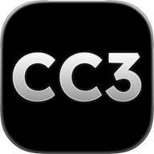

<p align="center">
  
</p>

<h1 align="center">CC3</h1>

<p align="center">The real Claude Code, in a desktop app with a browser, files and a terminal next to it.</p>

CC3 runs the actual Claude Code terminal UI in every chat. Next to it you get a built-in browser, a file explorer with previews, a terminal drawer and a chat list with live status. Claude knows it is running inside CC3 and uses these panels to show you things.

CC3 is a fork of [T3 Code](https://github.com/pingdotgg/t3code) (MIT) for the Linux desktop and Android. It stays mergeable with upstream.

## What you get

- **The real Claude Code.** Each chat is the Claude Code TUI, with its own theme, font and CC3 logo. Your subscription, your `~/.claude` settings, skills and MCP servers all apply. New chats can start in skip-permissions mode (a setting).
- **Chat list with status.** Folders for your chats, a spinner while Claude works, a yellow dot when it needs you, and a green dot when a chat finished while you were away. The dot goes away once you look at the chat.
- **Completion notification.** When a chat finishes while CC3 is in the background, a large card with a sound appears in the middle of the screen. Click it to open the chat, click outside to dismiss it.
- **Claude can use CC3.** It opens websites in the built-in browser, types commands that need you (such as `sudo`) into the terminal drawer and reads the result, and opens files in the file explorer. The matching panel comes to the front by itself.
- **File explorer.** Previews for code, Markdown, images, video, audio, PDF, HTML, fonts, SQLite, archives, notebooks and Office and OpenDocument files. The tree follows Claude when it changes directory with `cd` or `/cd`.
- **Terminal drawer.** A normal shell per chat, with split, new and hide buttons.
- **Split view.** Show two chats side by side.
- **Zoom.** `Ctrl` + `+`, `-` and `0` zoom the terminal. The window zoom is separate and stays remembered.
- **Android.** The Android app connects to the same server.

## Run it

CC3 is built from source. You need Node, pnpm and an installed, signed-in [Claude Code](https://claude.com/product/claude-code) (`claude auth login`).

```bash
pnpm install
pnpm build:desktop
pnpm start:desktop
```

Run `pnpm build:desktop` again after you change the sources. Chats and settings live in the CC3 data directory (`T3CODE_HOME`).

## Documentation

- [Install and first run](./docs/user/install.md)
- [Remote access from a phone or another machine](./docs/user/remote-access.md)
- [Permission modes](./docs/user/permission-modes.md)
- [Connect outside agents over MCP](./docs/user/outside-agents.md)
- [FAQ](./docs/user/faq.md)

These pages come from T3 Code and may still mention features CC3 removed. [All docs](./docs/README.md) has the full list.

## Development

- Work happens on `main` of this repository. `upstream` is T3 Code, and `git fetch upstream && git merge upstream/main` brings its changes in. CC3 behavior and branding win on conflicts.
- CC3 features live in new files where possible (for example `apps/desktop/src/cc3*.ts`, `apps/web/src/components/Cc3*.tsx`, `apps/server/src/terminal/cc3*.ts`). Edits to upstream files stay small.
- Read [AGENTS.md](./AGENTS.md) and the [development runbook](./docs/operations/development.md#first-checkout) before you change code.

## License

[MIT](./LICENSE). CC3 is based on T3 Code by T3 Tools.
